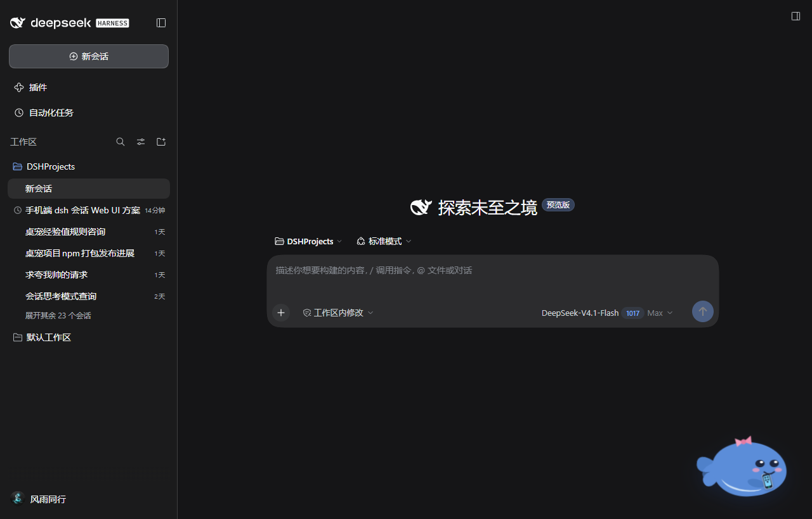

# dsh-whale-girl 🐳 鲸鱼女孩

> npm 包名：`@zyfgood/dsh-whale-girl`（配置里插件行的 `name:` 也必须写这个名字）。
> 仓库目录名 / 历史文档里的 `dsh-whale-girl` 指同一个插件。

DeepSeek Harness（DSH）插件：**鲸鱼女孩桌宠**。她住在 Web GUI 右下角，
实时反映 Agent 的工作状态，也能陪你玩。纯程序化 SVG + CSS 动画，
**零素材、零运行时依赖**，只读会话事件，不改会话与工作区文件。

## 手机访问（可选）

鲸鱼的右侧鳍里拿着一部小手机（需要 [`@zyfgood/dsh-mobile`](https://github.com/zyfgood/dsh-mobile)）：

- **点击手机**：打开/关闭手机端面板，面板自动锚定在桌宠上方；
- **右键菜单**：多一项 **📱 手机访问**；
- **手机连上**：她挥手说“手机连上啦～”，手机出现呼吸光环；手机断开后光环消失；
- **桌宠隐藏**：手机端入口自动回退到左下角按钮；恢复桌宠后按钮再隐去；
- 没装 `dsh-mobile` 时手机不出现；单击/双击/拖拽仍然是原来的戳戳/摸摸/移动。




集成走客户端服务 `dshMobile`，桌宠只调用 `open/close/toggle` 和读取 `status`，不接触手机端令牌。服务不存在时整个手机入口静默隐藏。

## 她会做什么

| Agent 在干嘛 | 鲸鱼女孩在干嘛 |
|---|---|
| 任务运行中 | 游泳 🏊 |
| 模型输出中 | 陪它思考，头顶泡泡 💭 |
| 调用工具 | 吐一个带友好标签的泡泡（敲命令 / 读文件 / 改文件 / …）🔧 |
| **请求批准** | **贴着屏幕敲玻璃 + 琥珀色脉冲 + 提醒气泡** 🔔 |
| 任务完成 | 跳起来庆祝 + 开口汇报："搞定！这一轮 X 分 Y 秒，跑了 N 个工具" 🎉 |
| 任务失败 | 下沉，眼睛变 > < 😢 |
| 闲置超时 | 主动讨活："我闲着呢，有活吗？" |
| 闲置更久 / 本地 00:00–06:00 | 戴睡帽睡觉 💤（睡觉时仍有呼吸动画） |

## 互动与成长

- **单击**：戳戳（随机台词 + 吱吱声，经验 +1；★2+ 偶尔对你 wink）
- **双击**：摸摸（好感 +2、经验 +2，浮出爱心；8 秒冷却；★1+ 害羞脸红）
- **拖拽**：移动位置，自动记住（按右/下边距锚定）；松手时惊慌扑腾一下
- **右键菜单**：喂食 🍤 / 挠痒痒 😆 / 击掌 🙌 / 抱抱 🤗 / 贴贴 🫂 / 哄睡 😴 / 静音 / 回默认位置 / 隐藏（隐藏后右下角小 🐳 恢复）
- **悬停**：成长卡片——等级、称号、经验条、**星级亲昵徽章**、好感进度、本轮/上轮统计

### 星级亲昵徽章与挂饰

好感每 60 点点亮一颗 ❤（最多 5 颗），每颗心的图案都不一样，越点越亲昵：
★1 小粉心 → ★2 双心相依 → ★3 心心相扣 → ★4 闪光心 → ★5 双心+小翅膀（家人）。
桌宠本体也会随星级换装：★2 星星发夹、★4 暖色围巾、★5 小皇冠。

### 星级解锁的互动

| 星级 | 解锁 |
|---|---|
| ★0 | 戳戳、摸摸、喂食、哄睡 |
| ★1 | 挠痒痒（大笑打滚）、摸摸害羞表情、台词库扩充 |
| ★2 | 击掌（+1 经验）、闲置时偷看/wink |
| ★3 | 抱抱（好感 +2、经验 +2，8 秒冷却）、`whale_say` 的 kiss/hug |
| ★4 | 闲置小剧场加跳舞、`whale_say` 的 dance |
| ★5 | 贴贴（好感 +3，60 秒冷却）、皇冠挂饰、家人台词 |

成长规则（**零负反馈**：永不扣分、永不惩罚）：

- 每完成一轮 +8 经验（失败也 +2）；成功轮好感 +1；互动另有加成（见上表）
- 等级 = `floor(sqrt(xp / 20)) + 1`；称号从「初来乍到」到「家人」共 6 档（每 4 级一档，Lv21 满称号）
- 好感每 60 点亮一颗 ❤（最多 5 颗）；台词库随星级混入更亲昵的句子
- 全部数据持久化在 `~/.dsh/whale-girl/state.json`

## whale_say 工具

插件向 Agent 注册 **`whale_say`** 工具（配置可关）：让鲸鱼女孩说一句话
（或附 `happy` / `sad` / `surprise` / `sleep` 动作；★3 起再解锁 `kiss` /
`hug`，★4 起 `dance`——星级不够会自动降级为 happy 并在结果里说明），
作为给用户的轻量可见通知通道——适合任务阶段性进展播报、温馨提醒、
小型庆祝。文本建议 ≤ 60 字，用用户的主要语言。若用户隐藏了桌宠或关了
台词，工具结果会如实告知。

## 配置（设置 → 插件 → whale-girl，或 profile patch）

| 字段 | 默认 | 说明 |
|---|---|---|
| `visible` | `true` | 启动时显示 |
| `size` | `160` | 尺寸（80–320 px） |
| `bubbleScale` | `1` | 气泡缩放（0.4–1.5） |
| `speechEnabled` | `true` | 台词气泡 |
| `soundsEnabled` | `true` | 合成音效（WebAudio 实时合成，零音频文件） |
| `petSayTool` | `true` | 向 Agent 提供 `whale_say` 工具 |
| `idleNagMinutes` | `5` | 闲置几分钟后主动讨活 |
| `sleepAfterMinutes` | `10` | 闲置几分钟后睡着 |

## Install / 安装

```bash
# Git 渠道（仓库根目录即插件）
dsh plugin --profile web add "github:zyfgood/dsh-whale-girl#main&path:/"
# 桌面版用 desktop profile：
dsh plugin --profile desktop add "github:zyfgood/dsh-whale-girl#main&path:/"

# npm 渠道（已发布）
dsh plugin --profile web add @zyfgood/dsh-whale-girl

# 本地开发（junction 链接，改 lib/client.js 保存即热更）
dsh plugin --profile desktop add /path/to/dsh-whale-girl
```

安装后打开（或刷新）DSH Web GUI 即可，无需重启 Host。卸载：
`dsh plugin --profile desktop remove @zyfgood/dsh-whale-girl`。

---

## English Summary

**dsh-whale-girl** is a desktop pet for the
[DeepSeek Harness](https://github.com/deepseek-ai/deepseek-harness) Web GUI:
a little whale girl living in the corner of the window who reflects your
agent's state in real time — swimming while tasks run, blowing labeled
bubbles on tool calls, **tapping the glass when an approval is waiting**,
backflipping with a duration/tool-count report on success, sinking with
`> <` eyes on failure, and wearing a nightcap after dark or when idle.

- **Hand-written SVG + CSS animation** — zero assets, zero runtime dependencies.
- **Interactions**: click to poke, double-click to pet (blush at ★1+), drag to
  reposition (remembered; she flails in surprise when dropped), right-click menu
  (feed / tickle / high-five / hug / snuggle / beddy-bye / mute / reset / hide),
  hover card with level, title, XP bar, tiered affinity badges and per-turn stats.
- **Growth**: XP and affinity from completed turns and interactions,
  6 titles from 初来乍到 to 家人; strictly positive — never penalizes.
  Affinity hearts (one per 60 points, max 5) unlock richer interactions,
  per-tier badge art (little heart → paired hearts → interlocked → sparkling →
  winged family hearts) and on-body costume pieces (hairclip / scarf / crown).
- **`whale_say` tool**: the agent can make her speak or perform an action
  (`happy` / `sad` / `surprise` / `sleep`; `kiss` / `hug` at ★3, `dance` at
  ★4, auto-downgraded with a note when locked) as a lightweight visible
  notification channel.
- **State machine** maps durable session events (`turn/start`, `tool/call`,
  `approval/asked`, `turn/end`, …) to moods; stats persist to
  `~/.dsh/whale-girl/state.json`.
- Read-only with respect to sessions and workspace files.

```bash
dsh plugin --profile web add "github:zyfgood/dsh-whale-girl#main&path:/"
# or from npm:
dsh plugin --profile web add @zyfgood/dsh-whale-girl
```

## 结构

```
lib/index.js    宿主半：session/event → 状态机；/whale-girl/state|act 路由；
                whale_say 工具注册；状态持久化（写回合并去抖）
lib/client.js   浏览器半：shell.overlay 槽位挂载；SVG 鲸鱼女孩 + CSS 动画；
                600ms 轮询快照 + 交互上报；WebAudio 合成音效
cordis.patch.yml         官方安装自动挂载的 bundle patch
cordis.patch.example.yml 手工挂载示例（不需要时忽略）
```

## License

MIT.
